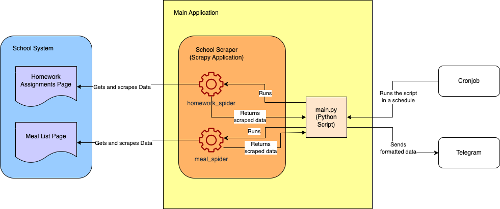
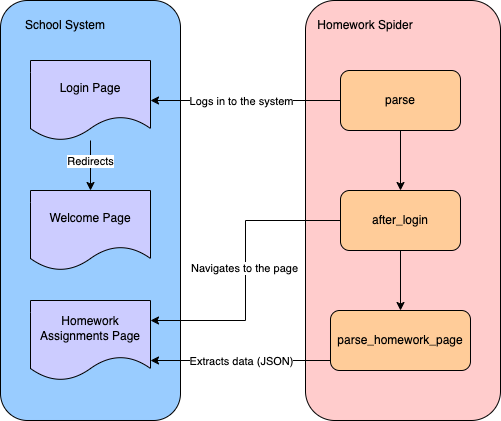

# 使用 Scrapy 进行网页爬虫

[](https://www.bright.cn/)

本指南通过一个实用的网页爬虫应用来解决家长常见的难题：收集并整理学校发送的信息。我们将重点介绍如何获取家庭作业详情和午餐菜单。

下面的架构图展示了我们将要构建的项目整体架构：



计划如下：

- [设置项目](#设置项目)
- [开发家庭作业爬虫](#开发家庭作业爬虫)
- [开发餐食爬虫](#开发餐食爬虫)
- [格式化数据](#数据格式化)
- [应对网页爬虫挑战](#应对网页爬虫挑战)

## 要求

开始本教程前，请确保你已：

- 安装 [Python 3.10+](https://www.python.org/downloads/)
- [激活 Python 虚拟环境](https://docs.python.org/3/library/venv.html)
- 通过 pip 安装 [Scrapy 2.11.1+](https://docs.scrapy.org/en/latest/intro/install.html#intro-install)
- 准备一个代码编辑器（例如 [VS Code](https://code.visualstudio.com/) 或 [PyCharm](https://www.jetbrains.com/pycharm/)）

出于隐私考虑，我们将使用这个演示学校网站：[https://systemcraftsman.github.io/scrapy-demo/website/](https://systemcraftsman.github.io/scrapy-demo/website/)

## 设置项目

首先，创建项目目录：

```sh
mkdir school-scraper
```

进入此目录并初始化一个新的 Scrapy 项目：

```sh
cd school-scraper & \
scrapy startproject school_scraper
```

这会生成如下文件夹结构：

```
school-scraper
└── school_scraper
    ├── school_scraper
    │   ├── __init__.py
    │   ├── items.py
    │   ├── middlewares.py
    │   ├── pipelines.py
    │   ├── settings.py
    │   └── spiders
    │       └── __init__.py
    └── scrapy.cfg
```

该命令会创建两个嵌套的 `school_scraper` 目录。在内层目录中，Scrapy 会生成几个关键文件：
- `middlewares.py`，用于定义 Scrapy [中间件](https://docs.scrapy.org/en/latest/topics/spider-middleware.html)
- `pipelines.py`，用于创建自定义数据处理管道
- `settings.py`，用于配置你的抓取应用
- 一个 `spiders` 文件夹，用于存放你的爬虫类

目前，`spiders` 文件夹为空，接下来我们将向其中添加内容。

## 开发家庭作业爬虫

要收集家庭作业信息，我们需要一个能够登录学校系统并导航至家庭作业页面的爬虫：



使用 Scrapy CLI 生成爬虫。在 `school-scraper/school_scraper` 目录中运行：

```sh
scrapy genspider homework_spider systemcraftsman.github.io/scrapy-demo/website/index.html
```

> **提醒：** 请确保在已激活的虚拟环境中运行所有 Python 和 Scrapy 命令。

你应该会看到类似以下内容的输出：

```
Created spider 'homework_spider' using template 'basic' in module:
  school_scraper.spiders.homework_spider
```

这会在 `school_scraper/spiders` 目录中创建包含以下内容的 `homework_spider.py`：

```python
class HomeworkSpiderSpider(scrapy.Spider):
    name = "homework_spider"
    allowed_domains = ["systemcraftsman.github.io"]
    start_urls = ["https://systemcraftsman.github.io/scrapy-demo/website/index.html"]

    def parse(self, response):
        pass
```

将类重命名为 `HomeworkSpider`，以移除名称中多余的 `Spider`。`parse` 方法是抓取流程的入口，我们将用它来登录。

> **注意：**
> 
> `https://systemcraftsman.github.io/scrapy-demo/index.html` 处的登录表单是使用 JavaScript 模拟的。由于它是静态 HTML 页面，我们将使用 HTTP GET 请求来模拟登录过程。

按如下方式更新 `parse` 方法：

```python
...code omitted...
    def parse(self, response):
        formdata = {'username': 'student',
                    'password': '12345'}
        return FormRequest(url=self.welcome_page_url, method="GET", formdata=formdata,
                           callback=self.after_login)
```

此方法会提交表单请求进行登录，然后重定向至 `welcome_page_url`，并通过 `after_login` 回调继续抓取。

将 `welcome_page_url` 添加到类变量中：

```python
...code omitted...
    start_urls = ["https://systemcraftsman.github.io/scrapy-demo/website/index.html"]
    welcome_page_url = "https://systemcraftsman.github.io/scrapy-demo/website/welcome.html"
...code omitted...
```

接下来，在 `parse` 方法之后添加 `after_login` 方法：

```python
...code omitted...
    def after_login(self, response):
        if response.status == 200:
            return Request(url=self.homework_page_url,
                           callback=self.parse_homework_page
                           )
...code omitted...
```

此方法会检查响应是否成功（状态码 200），然后导航至家庭作业页面并调用 `parse_homework_page` 方法。

将 `homework_page_url` 添加到类变量中：

```python
...code omitted...
    start_urls = ["https://systemcraftsman.github.io/scrapy-demo/website/index.html"]
    welcome_page_url = "https://systemcraftsman.github.io/scrapy-demo/website/welcome.html"
    homework_page_url = "https://systemcraftsman.github.io/scrapy-demo/website/homeworks.html"
...code omitted...
```

现在，在 `after_login` 之后添加 `parse_homework_page` 方法：

```python
...code omitted...
    def parse_homework_page(self, response):
        if response.status == 200:
            data = {}
            rows = response.xpath('//*[@class="table table-file"]//tbody//tr')
            for row in rows:
                if self._get_item(row, 4) == self.date_str:
                    if self._get_item(row, 2) not in data:
                        data[self._get_item(row, 2)] = self._get_item(row, 3)
                    else:
                        data[self._get_item(row, 2) + "-2"] = self._get_item(row, 3)
            return data
...code omitted...
```

此方法会验证响应状态码是否为 200，然后从 HTML 表格中提取家庭作业数据。它使用 XPath 获取表格行，再通过辅助方法 `_get_item` 提取特定数据。

将 `_get_item` 辅助方法添加到你的类中：

```python
...code omitted...
    def _get_item(self, row, col_number):
        item_str = ""
        contents = row.xpath(f'td[{col_number}]//text()').extract()
        for content in contents:
            item_str = item_str + content
        return item_str
```

此辅助方法使用 XPath 以及行列索引提取单元格内容。如果单元格包含多个文本节点，它会将这些节点拼接起来。

`parse_homework_page` 方法还需要一个 `date_str` 变量。我们将其设置为 `12.03.2024`，以匹配静态演示网站中的数据：

> **注意：**
> 
> 在实际应用中，你通常会动态生成此日期。

将 `date_str` 添加到类变量中：

```python
...code omitted...
    homework_page_url = "https://systemcraftsman.github.io/scrapy-demo/website/homeworks.html"
    date_str = "12.03.2024"
...code omitted...
```

完成后的 `homework_spider.py` 现在应如下所示：

```python
import scrapy

from scrapy import FormRequest, Request


class HomeworkSpider(scrapy.Spider):
    name = "homework_spider"
    allowed_domains = ["systemcraftsman.github.io"]
    start_urls = ["https://systemcraftsman.github.io/scrapy-demo/website/index.html"]
    welcome_page_url = "https://systemcraftsman.github.io/scrapy-demo/website/welcome.html"
    homework_page_url = "https://systemcraftsman.github.io/scrapy-demo/website/homeworks.html"
    date_str = "12.03.2024"

    def parse(self, response):
        formdata = {'username': 'student',
                    'password': '12345'}
        return FormRequest(url=self.welcome_page_url, method="GET", formdata=formdata,
                           callback=self.after_login)

    def after_login(self, response):
        if response.status == 200:
            return Request(url=self.homework_page_url,
                           callback=self.parse_homework_page
                           )

    def parse_homework_page(self, response):
        if response.status == 200:
            data = {}
            rows = response.xpath('//*[@class="table table-file"]//tbody//tr')
            for row in rows:
                if self._get_item(row, 4) == self.date_str:
                    if self._get_item(row, 2) not in data:
                        data[self._get_item(row, 2)] = self._get_item(row, 3)
                    else:
                        data[self._get_item(row, 2) + "-2"] = self._get_item(row, 3)
            return data

    def _get_item(self, row, col_number):
        item_str = ""
        contents = row.xpath(f'td[{col_number}]//text()').extract()
        for content in contents:
            item_str = item_str + content
        return item_str
```

运行以下命令测试你的爬虫：

```
scrapy crawl homework_spider
```

你应该会看到类似以下内容的输出：

```
...output omitted...
2024-03-20 01:36:05 [scrapy.core.scraper] DEBUG: Scraped from <200 https://systemcraftsman.github.io/scrapy-demo/website/homeworks.html>
{'MATHS': "Matematik Konu Anlatımlı Çalışma Defteri-6 sayfa 13'ü yapınız.\n", 'ENGLISH': 'Read the story "Manny and His Monster Manners" on pages 100-107 in your Reading Log and complete the activities on pages 108 and 109 according to the story.\n\nReading Log kitabınızın 100-107 sayfalarındaki "Manny and His Monster Manners" isimli hikayeyi okuyunuz ve 108 ve 109\'uncu sayfalarındaki aktiviteleri hikayeye göre tamamlayınız.\n'}
2024-03-20 01:36:05 [scrapy.core.engine] INFO: Closing spider (finished)
...output omitted...
```

## 开发餐食爬虫

为餐食列表页面创建另一个爬虫：

```sh
scrapy genspider meal_spider systemcraftsman.github.io/scrapy-demo/website/index.html
```

这会生成一个包含以下内容的新文件：

```python
class MealSpiderSpider(scrapy.Spider):
    name = "meal_spider"
    allowed_domains = ["systemcraftsman.github.io"]
    start_urls = ["https://systemcraftsman.github.io/scrapy-demo/website/index.html"]

    def parse(self, response):
        pass
```

餐食爬虫采用与家庭作业爬虫类似的模式，主要区别在于 HTML 解析逻辑。

将 `meal_spider.py` 的内容替换为：

```python
import scrapy

from datetime import datetime

from scrapy import FormRequest, Request


class MealSpider(scrapy.Spider):
    name = "meal_spider"
    allowed_domains = ["systemcraftsman.github.io"]
    start_urls = ["https://systemcraftsman.github.io/scrapy-demo/website/index.html"]
    welcome_page_url = "https://systemcraftsman.github.io/scrapy-demo/website/welcome.html"
    meal_page_url = "https://systemcraftsman.github.io/scrapy-demo/website/meal-list.html"
    date_str = "13.03.2024"

    def parse(self, response):
        formdata = {'username': 'student',
                    'password': '12345'}
        return FormRequest(url=self.welcome_page_url, method="GET", formdata=formdata,
                           callback=self.after_login)

    def after_login(self, response):
        if response.status == 200:
            return Request(url=self.meal_page_url,
                           callback=self.parse_meal_page
                           )

    def parse_meal_page(self, response):
        if response.status == 200:
            data = {"BREAKFAST": "", "LUNCH": "", "SALAD/DESSERT": "", "FRUIT TIME": ""}
            week_no = datetime.strptime(self.date_str, '%d.%m.%Y').isoweekday()
            rows = response.xpath('//*[@class="table table-condensed table-yemek-listesi"]//tr')
            key = ""
            try:
                for row in rows[1:]:
                    if self._get_item(row, week_no) in data.keys():
                        key = self._get_item(row, week_no)
                    else:
                        data[key] = self._get_item(row, week_no, "\n")
            finally:
                return data

    def _get_item(self, row, col_number, seperator=""):
        item_str = ""
        contents = row.xpath(f'td[{col_number}]//text()').extract()
        for i, content in enumerate(contents):
            item_str = item_str + content + seperator
        return item_str
```

请注意，`parse` 和 `after_login` 方法与家庭作业爬虫中的对应方法几乎相同。主要区别在于 `parse_meal_page` 方法，它使用不同的 XPath 表达式和数据处理逻辑提取餐食信息。

使用以下命令测试餐食爬虫：

```sh
scrapy crawl meal_spider
```

你应该会看到：

```
...output omitted...
2024-03-20 02:44:42 [scrapy.core.scraper] DEBUG: Scraped from <200 https://systemcraftsman.github.io/scrapy-demo/website/meal-list.html>
{'BREAKFAST': 'PANCAKE \n KREM PEYNİR \n SÜZME PEYNİR \n\nKAKAOLU FINDIK KREMASI \n SÜT\n', 'LUNCH': 'TARHANA ÇORBA\nEKŞİLİ KÖFTE\nERİŞTE\n', 'SALAD/DESSERT': 'AYRAN\nKIRMIZILAHANA SALATA\nROKALI GÖBEK SALATA\n', 'FRUIT TIME': 'FINDIK& KURU ÜZÜM\n'}
2024-03-20 02:44:42 [scrapy.core.engine] INFO: Closing spider (finished)
...output omitted...
```

## 数据格式化

现在，你的爬虫已经能够提取 JSON 格式的数据，你可能还希望通过编程方式触发爬虫，以更美观的格式呈现数据。

虽然 Scrapy 项目通常不需要 `main.py` 入口点（因为 Scrapy CLI 已提供运行爬虫所需的框架），但我们仍将创建一个入口点来格式化输出数据。

在 `school-scraper` 项目的根目录中创建名为 `main.py` 的文件，内容如下：

```python
import sys

from scrapy.crawler import CrawlerProcess
from scrapy.utils.project import get_project_settings

from school_scraper.school_scraper.spiders.homework_spider import HomeworkSpider
from school_scraper.school_scraper.spiders.meal_spider import MealSpider

results = []


class ResultsPipeline(object):
    def process_item(self, item, spider):
        results.append(item)


def _prepare_message(title, data_dict):
    if len(data_dict.items()) == 0:
        return None

    message = f"===={title}====\n----------------\n"
    for key, value in data_dict.items():
        message = message + f"==={key}===\n{value}\n----------------\n"

    return message


def main(args=None):
    if args is None:
        args = sys.argv
    settings = get_project_settings()
    settings.set("ITEM_PIPELINES", {'__main__.ResultsPipeline': 1})
    process = CrawlerProcess(settings)

    if args[1] == "homework":
        process.crawl(HomeworkSpider)
        process.start()
        print(_prepare_message("HOMEWORK ASSIGNMENTS", results[0]))
    elif args[1] == "meal":
        process.crawl(MealSpider)
        process.start()
        print(_prepare_message("MEAL LIST", results[0]))


if __name__ == "__main__":
    main()
```

此脚本为你的应用提供入口点。`main` 函数会处理命令行参数，以确定要运行哪个爬虫。

它会配置一个自定义 `ResultsPipeline`，将爬虫输出收集到 `results` 数组中。`_prepare_message` 辅助函数会格式化这些数据以供显示。

脚本会根据提供的参数（“homework”或“meal”）运行相应的爬虫并格式化其输出。

运行以下命令获取家庭作业：

```sh
python main.py homework
```

你应该会看到：

```
...output omitted...
====HOMEWORK ASSIGNMENTS====
----------------
===MATHS===
Matematik Konu Anlatımlı Çalışma Defteri-6 sayfa 13'ü yapınız.

----------------
===ENGLISH===
Read the story "Manny and His Monster Manners" on pages 100-107 in your Reading Log and complete the activities on pages 108 and 109 according to the story.

Reading Log kitabınızın 100-107 sayfalarındaki "Manny and His Monster Manners" isimli hikayeyi okuyunuz ve 108 ve 109'uncu sayfalarındaki aktiviteleri hikayeye göre tamamlayınız.

----------------
...output omitted...
```

获取餐食列表：

```sh
python main.py meal
```

输出：

```
...output omitted...
====MEAL LIST====
----------------
===BREAKFAST===
PANCAKE 
 KREM PEYNİR 
 SÜZME PEYNİR 

KAKAOLU FINDIK KREMASI 
 SÜT

----------------
===LUNCH===
TARHANA ÇORBA
EKŞİLİ KÖFTE
ERİŞTE

----------------
===SALAD/DESSERT===
AYRAN
KIRMIZILAHANA SALATA
ROKALI GÖBEK SALATA

----------------
===FRUIT TIME===
FINDIK& KURU ÜZÜM

----------------

...output omitted...
```

## 应对网页爬虫挑战

虽然 Scrapy 让网页爬虫变得相对简单，但在实际应用中，你仍可能遇到各种挑战。以下是处理常见障碍的一些建议：

### 动态网站

动态网站会根据位置、设备或偏好等因素向用户提供不同的内容。虽然 Scrapy 可以处理动态网站，但它并非专为此用途而设计。

对于动态内容，可以考虑安排 Scrapy 爬虫定期运行，并实现一个系统来跟踪内容随时间发生的变化。在某些情况下，你可以将更新不频繁的动态内容视为基本静态的内容。

### CAPTCHA

[CAPTCHA](https://www.bright.cn/blog/web-data/what-is-a-captcha) 是一种安全机制，它会显示需要人类识别才能继续操作的扭曲文本或图像。其专门用于阻止自动化抓取工具。

虽然我们的示例未使用 CAPTCHA，但你可能会在实际应用中遇到它。一种解决方案是创建 Scrapy 中间件来下载 CAPTCHA 图像，并使用 OCR（光学字符识别）库将其转换为文本。

### 会话和 Cookie 管理

Web 应用使用会话来维护用户浏览网站时的状态信息。Cookie 会将信息存储在用户设备上，供网站在后续访问期间读取。

在抓取过程中，你可能需要维持会话状态或操作 Cookie。Scrapy 内置了对 Cookie 和会话管理的支持，还可以通过第三方库获得更多功能。

### IP 封禁

许多网站会实施 [IP 封禁](https://brightdata.com/blog/proxy-101/how-to-bypass-an-ip-ban)，以防止来自单一来源的请求过多。如果网站检测到异常请求模式（例如来自爬虫机器人的请求），可能会暂时或永久封禁你的 IP 地址。

如果遇到 IP 封禁，可以考虑使用[动态 IP 地址](https://www.bright.cn/solutions/rotating-proxies)，将请求分散到多个 IP。

## 总结

对于希望增强网页爬虫能力的用户，Bright Data 提供了专为公开 Web 数据采集设计的解决方案。其 [Scrapy 集成](https://www.bright.cn/integration/scrapy)通过代理服务扩展了 Scrapy 的功能，帮助避免 IP 被封禁。

立即注册，与他们的数据专家沟通你的抓取需求。
